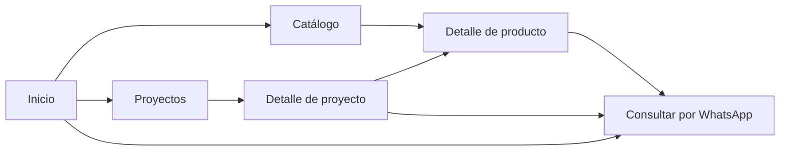

# Gestión Esencial: plan de definición previo al desarrollo

> Actualización aceptada (7 de noviembre de 2026): propietario/superadministrador, otros administradores, recuperación de contraseña y control de sesiones. El alcance vigente está en [06_PLAN_USUARIOS_Y_SESIONES.md](06_PLAN_USUARIOS_Y_SESIONES.md); sustituye la limitación anterior de administrador único. Implementado en local con correo simulado; producción pendiente.

Creado: 15 de octubre de 2026. Definición revisada: 17 de octubre. **Aceptado como base de desarrollo: 24 de octubre de 2026**.

Estado: alcance funcional aceptado para elaborar el plan de desarrollo. Este documento incorpora las respuestas A1–A10 y reemplaza las propuestas anteriores incompatibles. El stack, las fases, los límites de la primera versión y los costos se concretan en `04_PLAN_DE_DESARROLLO_Y_DESPLIEGUE.md`, preparado el 24 de octubre. Los datos aún por aportar no bloquean el desarrollo local.

Documentos relacionados: `01_CONTEXTO_Y_RECURSOS.md` y `03_MODELO_DE_DATOS_3FN.md`. El segundo es el diseño lógico solicitado; no es aún el plan de desarrollo y despliegue.

## 1. Decisiones confirmadas

| Tema | Decisión vigente |
| --- | --- |
| Objetivo | Landing corporativa, catálogo y proyectos, orientados a consultas comerciales por WhatsApp. |
| Compra | Sin carrito, checkout, pagos ni cuentas de clientes. |
| Pisos | Venta por caja; precio principal por caja y equivalente calculado por m², solo informativo. |
| Otros productos | Complementos como pegante, cemento, perfiles y zócalos. Todo se vende por producto/presentación completa: unidad o caja. Valores por kg, m² o metro lineal solo informativos. |
| Precios | COP y precio final; la actualización será responsabilidad del administrador. |
| Producto | Un producto independiente por SKU; nombre, imágenes, precio, descripción y ficha técnica. |
| SKU interno | Público en ficha, pequeño y con tratamiento tipográfico/color secundario; incluido en WhatsApp. |
| SKU externo | Privado y opcional. No aparece en HTML, respuestas públicas, buscador ni metadatos. |
| Proyecto | Nombre, SKU/referencia propia, ciudad e imágenes; relación con productos utilizados. |
| Relación | Muchos a muchos. La navegación comercial principal es proyecto → producto → WhatsApp. |
| Producto → proyecto | Sin enlaces de regreso a obras. Puede existir texto breve de respaldo con nombres de proyectos públicos. |
| Eliminación | Borrado lógico recuperable. Datos, archivos originales y relaciones se conservan; el contenido se oculta al público. |
| Administración | Un administrador inicial. Productos, proyectos y contenidos de la landing editables. |
| Carga inicial | Manual. |
| Inicio | Carrusel e información corporativa/comercial. |
| Filtros | Todos los que resulten aplicables a los datos y a la categoría seleccionada. |
| Identidad | Máxima fidelidad a los recursos existentes. Nombre, colores, logo y estilos se conservan. |
| Contenido de ejemplo | Imágenes y nombres de productos/proyectos son referenciales: pueden sustituirse, ampliarse o reorganizarse. |
| Presupuesto | 200.000 COP iniciales para dominio, infraestructura y certificados. Preferencia por pagos anuales y costo posterior mínimo conservando calidad. |
| Volumen inicial | «150» como referencia de volumen; aún sin desglose entre productos/proyectos ni fotos por registro. |

## 2. Relación y recorrido comercial

La relación muchos a muchos describe los datos; **no exige navegación bidireccional**. Normalizar la base de datos tampoco obliga a incluir enlaces del producto hacia los proyectos. No hay una regla de buenas prácticas que obligue a contradecir el objetivo comercial indicado.

Se conservan el menú global y la navegación habitual del navegador. La decisión es evitar módulos de recomendaciones que devuelvan desde la ficha de producto al portafolio; no bloquear que el visitante navegue libremente.

### Desde el proyecto

- Mostrar nombre, ciudad, galería y productos utilizados que estén publicados y no ocultos. Se propone mostrar también la referencia propia del proyecto de forma discreta; almacenarla ya está confirmado.
- Cada producto conduce a su ficha; el botón principal de esa ficha conduce a WhatsApp.
- Añadir una consulta general sobre el proyecto es una propuesta útil para visitantes que todavía necesitan asesoría. Su mensaje usaría el nombre y la referencia del proyecto, no un SKU de producto inventado.
- Si todos los productos vinculados están ocultos, omitir el bloque de productos. Se puede conservar una llamada genérica a asesoría sin prometer disponibilidad de esos materiales.
- Un proyecto puede publicarse sin asociaciones. Agregar/quitar una asociación no crea ni elimina los registros de producto/proyecto.

### Desde el producto

- Prioridad: galería, información, precio, unidad real de venta, referencia y WhatsApp.
- Como respaldo opcional: «Utilizado en Proyecto A y Proyecto B», **solo texto**, sin tarjetas, carrusel ni enlaces.
- Ese texto se obtiene de las asociaciones vigentes; no se copia manualmente a la descripción.
- No mencionar proyectos ocultos ni borradores. Usar datos reales para estas referencias en producción.

Evitar enlaces de regreso responde a la estrategia solicitada. No se afirma que por sí solo garantice más ventas; se podrá evaluar el resultado mediante consultas recibidas o métricas de clics, si se incorpora medición. Un clic a WhatsApp no equivale a una venta confirmada.

## 3. Referencias investigadas y propuesta de estructura

Consulta realizada el 17 de octubre de 2026 sobre páginas oficiales. Se revisó estructura y contenido accesible; no se realizó una auditoría visual completa ni de conversiones. Estas referencias sirven para organizar información; la estética seguirá los diseños de Gestión Esencial.

| Referencia | Qué se observó | Aplicación propuesta |
| --- | --- | --- |
| [ATRIM Colombia](https://www.atrimglobal.com/es-co) | Presentaciones destacadas, información corporativa, familias de productos, destacados y proyectos comerciales/residenciales. | Combinar identidad, acceso al catálogo y evidencia de aplicación en Inicio. Reducir secciones para el tamaño real de la empresa. |
| [Proyecto de ATRIM: Casa FOA Córdoba](https://www.atrimglobal.com/es-ar/proyectos/revestimientos-personalizados-y-color-en-casa-foa-cordoba-2026) | Presentación de una obra y bloque de productos utilizados con enlaces y SKU; ubicación y tipo de proyecto. | Referencia directa para proyecto → producto. No implica adoptar todas sus funciones o su navegación inversa. |
| [Decorceramica](https://www.decorceramica.com/) | Acceso por familias/espacios y tarjetas que identifican el precio con su unidad, como un o m². | Hacer explícita la unidad de cada importe. Su compra en línea no forma parte del alcance de Gestión Esencial. |
| [Corona: productos para interiores](https://corona.co/espacios/productos-para-interiores) | Entradas por tipos de solución, productos para ambientes y orientación para elegir. | Ofrecer accesos claros por necesidad/categoría, sin convertir la portada en una lista extensa de información. |

### Orden propuesto de Inicio

1. **Encabezado:** logo existente; Inicio, Catálogo, Nosotros, Proyectos, Contáctanos; búsqueda de productos. Quitar carrito y evitar desplegables sin contenido real.
2. **Carrusel:** mantener fotografía amplia, tratamiento azul, títulos y composición del diseño. Propuesta inicial: tres diapositivas editables, cada una con mensaje corto y un botón hacia catálogo, categoría o WhatsApp según su contenido. Flechas, indicadores y control accesible; sin reproducción automática por defecto, pendiente de revisión visual.
3. **Acceso a categorías:** pisos y complementos realmente disponibles. Evitar mostrar categorías vacías.
4. **Productos destacados:** selección manual breve, conservando las tarjetas de imagen y pie azul. No seleccionar automáticamente contenido oculto.
5. **Asesoramos, distribuimos e instalamos:** servicios, alcance y botón «Solicitar asesoría». Mantener el lenguaje del diseño.
6. **Proyectos seleccionados:** conservar tarjetas fotográficas grandes. Cada obra conduce a sus materiales y estos a WhatsApp.
7. **Nosotros y confianza:** extracto de experiencia y cifras verificadas. No inventar testimonios, obras ejecutadas o antigüedad para llenar el diseño.
8. **Contacto:** cierre con WhatsApp y datos de la empresa; pie de página.

Este orden es una propuesta concreta para revisar, no una nueva obligación confirmada. Los bloques pueden ajustarse manteniendo categorías/productos visibles antes de información corporativa extensa.

### Páginas y componentes propuestos

| Área | Alcance |
| --- | --- |
| Catálogo | Búsqueda, categorías, filtros contextuales, ordenamiento, paginación y tarjetas. |
| Producto | Galería, precio por unidad real de venta, equivalentes informativos cuando apliquen, SKU interno, descripción, ficha y WhatsApp. |
| Proyectos | Galería y filtros de sector/ciudad que existan en los datos. |
| Proyecto | Nombre, SKU, ciudad, galería, breve descripción opcional y productos públicos vinculados. |
| Nosotros | Página de composición fiel a la referencia, con contenido editable; resumen en Inicio. |
| Servicios | Bloque en Inicio en la propuesta inicial. Página independiente solo si el contenido lo justifica. |
| Contacto | Sección de Inicio accesible desde el menú y datos corporativos. Se propone WhatsApp como canal principal; formulario aún no confirmado. |
| Administración | Acceso privado, listas, formularios, carga/orden de imágenes, edición de landing y vista de registros ocultos para recuperar. |

## 4. Unidades, precios y ficha técnica

### Separar venta real de equivalencia informativa

Cada producto tiene **una presentación completa de venta**, expresada como unidad o caja, y un precio final por esa presentación. Un saco, bolsa o pieza describe qué constituye una unidad comercial. Los valores por kg, m² o metro lineal son únicamente informativos: no se contempla venta fraccionada. Si cambia la presentación comercial de manera que representa otro artículo, se propone otro SKU/producto, coherente con la decisión de no agrupar variantes.

| Ejemplo ficticio | Unidad real de venta | Dato de presentación | Precio principal | Información derivada |
| --- | --- | --- | --- | --- |
| Piso | Caja | 1,60 m²/caja | $120.000 COP/caja | $75.000 COP/m²; venta por caja completa. |
| Cemento | Unidad: saco completo | 50 kg/saco | $40.000 COP/unidad (saco) | $800 COP/kg; informativo, no venta de kilos sueltos. |
| Zócalo | Unidad: pieza completa | 2,40 m lineales/pieza | $24.000 COP/unidad (pieza) | $10.000 COP/m lineal; informativo, no cortes por metro. |

La venta por presentaciones completas está confirmada. Los pesos, longitudes y precios de estos ejemplos son ficticios; el administrador cargará los de cada SKU. «Según disponibilidad» no cambia automáticamente la presentación: un registro siempre debe expresar con claridad qué producto completo corresponde a su precio.

**Fórmula para pisos:** `precio informativo por m² = precio final por caja / m² por caja`.

Reglas propuestas:

- Guardar precio final y cobertura/contenido; calcular el equivalente. No editar dos precios independientes para la misma presentación.
- La cobertura en m² por caja se introduce en la ficha y se guarda una sola vez, como medida de la presentación; la ficha y el precio calculado consultan ese mismo valor.
- Calcular únicamente con datos positivos y de la dimensión correspondiente. Sin cobertura válida, no mostrar un equivalente. Para publicar un piso por caja se propone exigir m² por caja.
- No convertir kg a m²: el rendimiento de un adhesivo depende del uso y no es una conversión universal de unidades.
- Precio principal con mayor jerarquía; equivalente más pequeño y rotulado como «Equivalente informativo». Añadir «Venta por caja completa» donde corresponda.
- Mostrar precio final en COP, sin sumar recargos de impuestos en la ficha. No inferir que instalación o transporte están incluidos: sus condiciones deben aclararse.
- Propuesta: exigir precio final válido para publicar. Un precio aún pendiente puede guardarse en borrador; no sustituirlo por cero.
- Usar cálculo decimal, conservar precisión y redondear solo para visualización. El importe por unidad de venta es la referencia comercial.

### Datos comerciales y técnicos

| Grupo | Datos |
| --- | --- |
| Identificación | Nombre, SKU interno único, SKU externo opcional/privado, categoría y descripción. |
| Venta | Precio final COP, unidad real de venta y fecha de última actualización del precio. |
| Presentación | m², kg, metros lineales y/o piezas por unidad de venta, solo cuando correspondan. |
| Pisos | Largo, ancho y espesor; cobertura por caja; piezas por caja cuando se conozcan; material, acabados, colores y usos/áreas aplicables. |
| Otros artículos | Peso o longitud por presentación y especificaciones relevantes; no exigirles la ficha de un piso. |
| Información complementaria | Garantía, ventajas, atributos, recomendaciones de instalación/mantenimiento y notas. |
| Imágenes | Galería ordenable, portada y texto alternativo. |
| Gestión | Borrador/publicado y fecha de borrado lógico, tratadas como conceptos separados. |

La ficha es una estructura de información del catálogo, no una certificación técnica. Los datos especializados se obtienen de documentación real, sin inventar resistencias ni rendimientos. Adjuntar un PDF técnico queda como opción pendiente; la información principal debe ser legible en la página.

### Filtros coherentes

Se incluyen categoría, acabado, color, medidas, precio y los demás atributos relevantes que existan en los datos; en proyectos, sector y ciudad. Un campo no aplicable a la selección no produce un filtro vacío.

No comparar ni ordenar como equivalentes «$40.000 por saco completo» y «$10.000 por metro informativo». Propuesta: filtrar/ordenar por precio dentro de familias y presentaciones comparables; entre pisos, se puede ofrecer una comparación explícita por m² informativo. Que dos artículos se vendan por «unidad» no hace comparable un saco con una pieza de zócalo. Nunca mezclar bases de precio sin rotularlas. El buscador principal se propone centrado en nombre y SKU interno de productos; no usa el SKU externo.

## 5. Borrado lógico, recuperación e histórico

**Se reemplaza la propuesta de archivo visible y eliminación definitiva.** En la interfaz, «Eliminar» significará ocultar mediante borrado lógico, con explicación de que se puede recuperar. No habrá botón, API de negocio ni proceso automático de purga para eliminar definitivamente contenidos.

- Producto/proyecto y asociaciones se conservan. Marcar `deleted_at` oculta; no destruye filas ni imágenes originales.
- La condición pública exige publicado y sin borrado lógico, además de relaciones vigentes y recursos autorizados.
- El registro oculto desaparece del catálogo, búsquedas, filtros, destacados, proyectos relacionados, texto de respaldo, sitemap, metadatos y respuestas públicas.
- Una URL directa no vuelve a mostrarlo ni ofrece una consulta sobre ese producto; se propone respuesta de no encontrado y acceso general al catálogo/contacto.
- Se invalidan las páginas, consultas e imágenes servidas desde caché que dependan de su visibilidad. El diseño técnico deberá incluirlo; no basta un filtro visual.
- Borrar un producto no borra sus proyectos; borrar un proyecto no borra sus productos.
- Quitar una relación marca esa asociación como retirada; no destruye su fila. Volver a vincular reactiva la misma pareja sin duplicarla.
- Los registros ocultos pueden editarse desde administración. Propuesta de recuperación: vuelven como borrador para revisar precio, fotografías y disponibilidad antes de publicar expresamente.
- Los SKU permanecen reservados para el mismo registro incluso al ocultarlo. Los errores se corrigen en ese registro, preservando su ID y sus relaciones.
- Una fotografía reemplazada se conserva como recurso privado; no se borra el archivo histórico. Si una imagen está compartida, su visibilidad pública depende de que tenga al menos un uso público válido.

Conservar registros con borrado lógico **no conserva por sí solo cada valor anterior** después de editar un nombre, precio o descripción. Se propone una bitácora de operaciones, incluida ocultación/restauración. Esta bitácora no garantiza reconstruir cada valor previo: el versionado completo sería un alcance adicional, explicitado en el modelo 3FN. Ninguno reemplaza una copia de seguridad.

La aplicación puede impedir nuevas respuestas públicas de registros ocultos; no puede retirar copias que un visitante ya descargó ni garantizar eliminación instantánea de índices externos. Los originales históricos se conservarán con acceso privado.

## 6. Administración, contenidos y WhatsApp

Un administrador inicial, sin registro público. Carga manual. Se propone un panel sencillo con productos, proyectos, contenidos y registros ocultos; sin sistema de aprobación entre múltiples personas.

Los componentes de la landing conservarán estructura y estilo. El administrador podrá editar carrusel, textos, servicios, imágenes, contacto y selección de destacados. Propongo campos definidos y vista previa, no un editor libre de código/estilos. El carrusel sí está confirmado; los límites exactos de edición quedan sujetos a esta revisión.

En la ficha, el SKU interno aparecerá como referencia secundaria: más pequeño que el título, color discreto con contraste legible y una tipografía descriptiva diferenciada. Puede usarse una fuente de sistema monoespaciada para la referencia, sin alterar Gill Sans como tipografía principal ni el logo. El tratamiento exacto se validará en el diseño.

Mensaje de producto:

> Hola, estoy interesado en [nombre del producto], SKU [SKU interno], y me interesa más información.

El botón abre el texto preparado; el visitante decide enviarlo. Número configurable, un destino inicial propuesto, sin bot ni envío automático. El SKU externo queda fuera. Agregar URL de producto es opcional. En móvil se propone un acceso a WhatsApp persistente que no tape contenido ni controles.

## 7. Respuestas A1–A10 y pendientes reales

| ID original | Estado actual |
| --- | --- |
| A1 | Resuelto: relación muchos a muchos, proyecto → producto → WhatsApp; respaldo textual opcional sin enlaces inversos. |
| A2 | Resuelto: SKU interno visible y discreto; externo privado y opcional. |
| A3 | Resuelto: COP y precio final. La actualización es manual; no se presupone sincronización de inventario/precios. |
| A4 | Resuelto: otros artículos incluidos; todos por unidad o caja completa. Equivalentes por medida únicamente informativos. Cada SKU define su embalaje y contenido real. |
| A5 | Resuelto: filtros aplicables por familia/datos. Aquí se propone cómo evitar comparar precios con unidades distintas. |
| A6 | Resuelto: solo borrado lógico recuperable, ocultación pública y corrección de errores sin eliminación definitiva. |
| A7 | Resuelto: un administrador inicial. |
| A8 | Carrusel confirmado. Investigación y estructura propuesta incluidas en sección 3, pendientes de tus ajustes. |
| A9 | Carga manual confirmada; volumen inicial indicado: 150. Falta desglose de productos/proyectos y fotografías para dimensionar almacenamiento. |
| A10 | 200.000 COP iniciales para dominio, infraestructura y certificados. Pagos anuales preferidos; minimizar recurrencia conservando calidad. Aún no hay un techo anual futuro explícito. |

### Precisiones restantes para el presupuesto técnico

- Desglosar el volumen «150»: productos/proyectos y fotos aproximadas por registro. No se asumirá que son 150 de cada uno. Si aún no se conoce, se presupuestarán escenarios explícitos.
- Dominio existente o por comprar y expectativa de crecimiento. El presupuesto ya tiene destino confirmado; no se volverá a preguntar qué conceptos cubre.
- El plan técnico comparará costo de arranque y renovación anual, incluyendo qué certificados vienen integrados y cuáles requerirían pago. No se presupone comprar un certificado por separado ni se afirma que sea necesario.

### Antes de implementar/publicar

- Ajustar la estructura propuesta de Inicio y límites de edición. Mantener WhatsApp como contacto principal; decidir si también se requiere formulario, PDF técnico o medición de clics.
- Confirmar dominio existente, fecha objetivo y responsable de operación; no hacen falta credenciales en esta fase.
- Aportar teléfono, contactos, contenidos reales y recursos autorizados para producción. Los ejemplos pueden usarse en prototipos claramente identificados.
- Resolver archivo y permiso de uso web de Gill Sans regular, todavía no encontrado en los recursos entregados.
- Sector de proyecto se contempla para los filtros existentes; descripción breve opcional propuesta. El SKU de proyecto está confirmado como dato almacenado; se propone mostrarlo también como referencia discreta en el detalle.
- Se propone sitio en español. Otros idiomas no están incluidos automáticamente.

No se repiten como pendientes las decisiones ya respondidas. Los datos finales pueden llegar durante la preparación de contenidos; volumen, presupuesto y reglas comerciales sí afectan las recomendaciones técnicas.

## 8. Criterios de aceptación actualizados

- El piso muestra precio por caja y equivalente por m² correcto, sin insinuar venta fraccionada.
- Otros productos rotulan la unidad real de venta; las conversiones informativas solo usan medidas compatibles.
- El SKU interno es visible y el externo no se filtra a ninguna superficie pública.
- Los proyectos tienen referencia propia y enlazan productos; las fichas de producto no tienen enlaces de vuelta a obras.
- La consulta de WhatsApp contiene nombre y SKU del producto correcto, conservando caracteres especiales.
- Un producto oculto no aparece ni siquiera desde un proyecto o una URL directa. Lo mismo se aplica a proyectos ocultos.
- Ocultar/restaurar no elimina filas, asociaciones ni archivos originales; restaurar requiere revisión antes de republicar.
- Se puede corregir información manteniendo identidad y relaciones; conservar un registro no se confunde con mantener todas sus versiones anteriores.
- El administrador carga y ordena imágenes, edita información y contenidos de la landing dentro del diseño establecido.
- Carrusel, filtros, galerías y contacto funcionan en móvil y escritorio; existen estados vacíos y de error.
- Se conserva identidad y estilo; las imágenes y nombres de demostración no se publican como casos reales sin validación.

## 9. Paso siguiente y plan técnico posterior

El modelo en `03_MODELO_DE_DATOS_3FN.md` desarrolla la estructura solicitada. Tras la conformidad del usuario, se elaboró `04_PLAN_DE_DESARROLLO_Y_DESPLIEGUE.md`: stack y alternativas, fases, datos, autenticación, archivos, pruebas, seguridad, rendimiento, copias/restauración, escalabilidad y costos verificados al 24 de octubre. La implementación todavía no ha comenzado.

El costo deberá incluir dominio, cómputo, base de datos, almacenamiento de originales e imágenes optimizadas, entrega/transformación, certificados y copias. El mantenimiento se explicará por separado del presupuesto de infraestructura. Conservar todo el histórico tiene un costo acumulativo que deberá dimensionarse. Los 200.000 COP son presupuesto inicial de servicios, no un presupuesto mensual ni de desarrollo. Se preferirá facturación anual cuando exista y resulte conveniente; no se promete operación gratuita.
