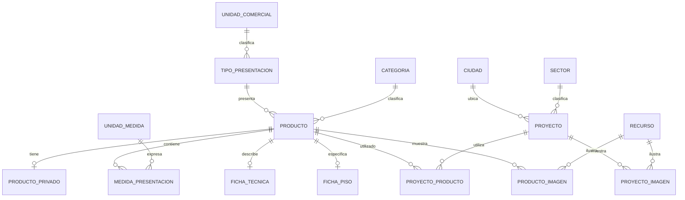

# Gestión Esencial: modelo lógico de datos en 3FN

> Actualización de alcance (7 de noviembre de 2026): la entidad administrativa de este documento se sustituye por usuarios, roles, credenciales, sesiones y tokens según [06_PLAN_USUARIOS_Y_SESIONES.md](06_PLAN_USUARIOS_Y_SESIONES.md). Implementado en SQLite local mediante `003_accounts.sql`; falta validación/migración en D1. Las entidades de catálogo y proyectos se conservan.

Fecha: 17 de octubre de 2026. Aceptado como base lógica el 24 de octubre de 2026. El plan `04_PLAN_DE_DESARROLLO_Y_DESPLIEGUE.md` concreta su implementación en D1, escalas numéricas y extensiones operativas; no se ha ejecutado ninguna migración.

Este documento desarrolla el catálogo, proyectos, relación entre ambos, imágenes y contenidos editables. Incorpora venta por presentación completa, precios equivalentes informativos y borrado lógico. No es una migración ejecutada ni el plan de desarrollo/despliegue.

## 1. Reglas del negocio que gobiernan el modelo

1. Un producto comercial se identifica con un SKU interno único y tiene una presentación de venta completa: caja o unidad. Saco, bolsa o pieza describen qué contiene esa unidad comercial.
2. El precio final COP corresponde a una presentación completa. Los importes por m², kg o metro lineal se calculan para informar; no habilitan venta fraccionada.
3. Cada SKU corresponde a un producto independiente. Si un artículo se ofrece en dos presentaciones distintas, la propuesta es tratarlas como SKU/productos diferentes, manteniendo esta regla.
4. Cada proyecto tiene su propia referencia/SKU, independiente del SKU del producto.
5. Un proyecto puede usar muchos productos y un producto puede usarse en muchos proyectos; ambos pueden existir sin asociaciones.
6. La navegación pública es proyecto → producto → WhatsApp. El sentido de los enlaces de la interfaz no cambia la cardinalidad de los datos.
7. No se borran físicamente registros de negocio, asociaciones ni originales de medios. Se conserva el registro y se oculta mediante `deleted_at`.
8. El SKU externo es opcional y privado. No es una clave candidata: no se supone único ni se usa para relacionar entidades.
9. Los productos/proyectos ocultos y sus asociaciones no pueden filtrarse por otra ruta pública. Restaurar no implica publicar automáticamente.
10. Carga manual y un administrador inicial. No se incluye inventario, facturación, órdenes, pagos ni seguimiento de cantidades instaladas en obras.

## 2. Diagrama de las relaciones principales

El diagrama muestra relaciones de datos, **no enlaces que el usuario verá en la página**. Los catálogos secundarios y el contenido corporativo se detallan después para mantenerlo legible.



El recorrido público no contiene producto → proyecto. La eventual lista textual de obras en una ficha se consulta a través de `PROYECTO_PRODUCTO`, sin generar enlaces.

## 3. Convenciones

- `PK`: clave primaria. `FK`: clave foránea. `UQ`: unicidad. `?`: valor opcional.
- IDs internos estables, independientes del nombre y del SKU. Se puede corregir el SKU sin reconstruir asociaciones.
- SKU y códigos se guardan como texto: conservar ceros iniciales y separadores. Se propone normalización de espacios y comparación sin diferencias de mayúsculas; confirmar formato antes de implementar.
- Importes y medidas con decimal exacto. No usar coma flotante binaria para dinero. El motor físico determinará si se implementa con decimal o enteros escalados.
- `precio_final_cop` identifica explícitamente la moneda; no se agrega una columna de moneda repetida cuando todo el catálogo opera solo en COP.
- En entidades y asociaciones editables, agregar `created_at`, `updated_at`, `deleted_at?`, `created_by FK`, `updated_by FK`, `deleted_by FK?` y `motivo_ocultacion?`. Cada tabla conserva su propia vigencia; ocultar un padre no modifica en cascada las marcas de sus hijos.
- Los catálogos de unidades son semillas controladas; el administrador no redefine qué significa kg, m² o caja. Una etiqueta corregida no debe alterar el significado de un registro.
- Publicación y borrado son ejes separados: `estado_publicacion ∈ {BORRADOR, PUBLICADO}` más `deleted_at`. No agregar `activo`, `archivado` o `visible` redundantes que puedan contradecirse.
- Los campos pueden estar incompletos durante un borrador cuando se indica. Publicar exige las validaciones de la sección 8.

## 4. Tablas del núcleo

### 4.1 Producto y datos privados

| Tabla | Campos de negocio | Claves y reglas |
| --- | --- | --- |
| `PRODUCTO` | `producto_id`, `sku_interno`, `slug`, `nombre`, `descripcion?`, `categoria_id FK`, `presentacion_codigo FK`, `precio_final_cop?`, `precio_actualizado_at?`, `estado_publicacion` | PK `producto_id`; UQ `sku_interno`; UQ `slug`. Precio positivo al publicar. Una categoría principal y una presentación por SKU en esta propuesta. |
| `PRODUCTO_PRIVADO` | `producto_id`, `sku_externo?` | PK/FK `producto_id → PRODUCTO`. Relación 0..1 por producto. Puede no existir mientras no haya datos privados. Sin UQ sobre SKU externo. |
| `CATEGORIA` | `categoria_id`, `codigo`, `nombre` | PK `categoria_id`; UQ `codigo`. No repetir nombre de categoría dentro de PRODUCTO. Inicialmente categorías simples, sin jerarquía obligatoria. |

Separar `PRODUCTO_PRIVADO` ayuda a limitar proyecciones y permisos de lectura, aunque la privacidad sigue dependiendo de autorización real. La API pública selecciona columnas permitidas expresamente; no serializa filas completas ni joins privados. El SKU externo tampoco participa en búsqueda, metadatos, enlaces o eventos de analítica públicos.

El nombre y la referencia del producto se leen desde PRODUCTO al formar el mensaje de WhatsApp. No se almacena una copia del mensaje por producto.

### 4.2 Presentación comercial y medidas

| Tabla | Campos | Claves y reglas |
| --- | --- | --- |
| `UNIDAD_COMERCIAL` | `codigo`, `nombre` | PK `codigo`. Semillas: `CAJA`, `UNIDAD`. |
| `TIPO_PRESENTACION` | `codigo`, `nombre`, `unidad_comercial_codigo FK` | PK `codigo`. Ej.: CAJA → CAJA; SACO, BOLSA, PIEZA o ENVASE → UNIDAD. La etiqueta describe la presentación completa. |
| `UNIDAD_MEDIDA` | `codigo`, `nombre`, `simbolo`, `dimension` | PK `codigo`. Conjunto canónico: `M2` (área), `KG` (masa), `ML` (longitud; aquí significa metro lineal, no mililitro), `PIEZA` (conteo). No se habilitan códigos ambiguos en la UI. |
| `MEDIDA_PRESENTACION` | `producto_id FK`, `unidad_medida_codigo FK`, `cantidad` | PK compuesta `(producto_id, unidad_medida_codigo)`. Cantidad positiva de esa medida contenida en **una presentación comercial completa de ese producto**. |

PRODUCTO guarda `presentacion_codigo`, **no** también `unidad_comercial_codigo`: este último se obtiene a través de TIPO_PRESENTACION. Así no se duplica la dependencia presentación → unidad comercial.

MEDIDA_PRESENTACION no es un sistema libre de atributos: solo admite medidas cuantitativas conocidas con unidades controladas. No guarda precios ni etiquetas de categorías. Cada producto puede tener, por ejemplo, cobertura en m², peso en kg y número de piezas sin crear columnas repetidas o listas dentro de una celda.

La cobertura **m² por caja** está físicamente en `MEDIDA_PRESENTACION(producto_id, 'M2')` para un producto de presentación CAJA. El formulario la presenta como parte de la ficha técnica, y ambas vistas usan la misma fila. No se añade otra copia de `m2_por_caja` en FICHA_PISO.

Para un saco, la medida KG expresa contenido neto del saco, no peso del embalaje. Para una pieza de zócalo, la medida de longitud expresa cuántos metros lineales contiene esa pieza. Si se necesitan peso bruto u otras magnitudes con significado diferente, se modelarán explícitamente; no se reutilizará una columna con dos significados.

### 4.3 Ficha técnica y filtros

| Tabla | Campos | Claves y reglas |
| --- | --- | --- |
| `FICHA_TECNICA` | `producto_id`, `garantia_meses?`, `atributos?`, `ventajas?`, `instalacion?`, `mantenimiento?`, `notas?` | PK/FK `producto_id → PRODUCTO`. Texto descriptivo y garantía del producto; valores opcionales según familia. |
| `FICHA_PISO` | `producto_id`, `largo_mm?`, `ancho_mm?`, `espesor_mm?` | PK/FK `producto_id → PRODUCTO`. Dimensiones físicas de una pieza de piso, no de la caja. Solo aplica a pisos. Medidas positivas cuando existan. |
| `COLOR` | `color_id`, `codigo`, `nombre` | PK `color_id`; UQ `codigo`. |
| `PRODUCTO_COLOR` | `producto_id FK`, `color_id FK` | PK compuesta. Permite productos multicolor sin guardar una lista en PRODUCTO. |
| `ACABADO` | `acabado_id`, `codigo`, `nombre` | PK `acabado_id`; UQ `codigo`. |
| `PRODUCTO_ACABADO` | `producto_id FK`, `acabado_id FK` | PK compuesta. Varios acabados/atributos de terminación si corresponde. |
| `USO` | `uso_id`, `codigo`, `nombre` | PK `uso_id`; UQ `codigo`. Ej.: residencial, comercial. |
| `PRODUCTO_USO` | `producto_id FK`, `uso_id FK` | PK compuesta. |
| `AREA_APLICACION` | `area_id`, `codigo`, `nombre` | PK `area_id`; UQ `codigo`. Ej.: cocina, exterior. |
| `PRODUCTO_AREA` | `producto_id FK`, `area_id FK` | PK compuesta. |

La categoría identifica la familia comercial. Si se requiere un material independiente de esa familia o marca/fabricante, se añadirá su catálogo y FK propios; no se inventan datos ni se repiten valores que ya determina la categoría. Los filtros iniciales usan las dimensiones de FICHA_PISO, las medidas de presentación y las asociaciones definidas.

Una garantía o recomendación de un piso no se impone a un saco de cemento. Para perfiles, adhesivos u otras familias, cualquier especificación estructurada adicional se diseñará con su significado y unidad antes de incorporarla; el peso y longitud de la presentación ya están cubiertos. Evitar una tabla libre de pares «campo/valor» para toda la ficha, que dificultaría tipos, validación y filtros.

Los textos de atributos/ventajas no sustituyen a los catálogos cuando una propiedad necesita filtrarse. Una propiedad filtrable se guarda estructurada una sola vez.

### 4.4 Proyecto y ubicación

| Tabla | Campos | Claves y reglas |
| --- | --- | --- |
| `PROYECTO` | `proyecto_id`, `sku_proyecto`, `slug`, `nombre`, `ciudad_id FK?`, `sector_id FK?`, `descripcion?`, `estado_publicacion` | PK `proyecto_id`; UQ `sku_proyecto`; UQ `slug`. Ciudad requerida al publicar. Referencia propia, no una lista de SKU de materiales. |
| `SECTOR` | `sector_id`, `codigo`, `nombre` | PK `sector_id`; UQ `codigo`. Se propone un sector principal por proyecto para los filtros del diseño. |
| `PAIS` | `pais_codigo`, `nombre` | PK `pais_codigo`. Inicialmente Colombia. |
| `REGION` | `region_id`, `pais_codigo FK`, `codigo`, `nombre` | PK `region_id`; UQ `(pais_codigo, codigo)`. Para Colombia, departamentos/distritos según el catálogo elegido. |
| `CIUDAD` | `ciudad_id`, `region_id FK`, `codigo`, `nombre` | PK `ciudad_id`; UQ `(region_id, codigo)`. Desambiguar ciudades del mismo nombre. |

PROYECTO no repite ciudad, departamento ni país como cadenas. El dato país se obtiene desde región; ciudad no repite el país. Si todos los proyectos siguen siendo colombianos, puede haber una sola fila PAIS sin afectar el modelo.

`sku_proyecto` es una referencia administrativa confirmada. Se propone mostrarla también de forma discreta en el detalle y usarla en consultas de proyecto si se habilitan; esa presentación pública sigue sujeta a revisión. No es necesario un prefijo concreto, aunque separar prefijos de producto y proyecto facilita reconocerlos.

### 4.5 Relación muchos a muchos

```text
PROYECTO_PRODUCTO
  proyecto_id  PK, FK → PROYECTO.proyecto_id
  producto_id  PK, FK → PRODUCTO.producto_id
  orden       entero >= 0
  created_at, updated_at, deleted_at?
  created_by, updated_by, deleted_by?, motivo_ocultacion?
```

- PK `(proyecto_id, producto_id)`; cada pareja existe una sola vez, incluso después de retirarla lógicamente.
- `orden` pertenece al producto dentro de ese proyecto. No es el orden del producto en todo el catálogo.
- No guardar aquí nombre, SKU, precio, ciudad ni imagen: dependen de otras entidades.
- Reactivar la misma pareja borra su marca lógica, sin insertar duplicados. Un producto/proyecto oculto no se restaura por reactivar una asociación.
- No se registra cantidad instalada ni precio histórico de obra: no fueron solicitados.
- FK con restricción de borrado físico; sin cascadas de eliminación. El acceso operativo no tendrá función de eliminación física.

### 4.6 Recursos e imágenes

| Tabla | Campos | Claves y reglas |
| --- | --- | --- |
| `RECURSO` | `recurso_id`, `clave_almacenamiento`, `nombre_original`, `tipo_mime`, `bytes`, `ancho_px?`, `alto_px?` | PK `recurso_id`; UQ `clave_almacenamiento`. Original inmutable: reemplazar crea un recurso nuevo y conserva el anterior privado. |
| `PRODUCTO_IMAGEN` | `producto_id FK`, `recurso_id FK`, `posicion`, `texto_alternativo` | PK `(producto_id, recurso_id)`. Orden sin repetir posición entre asociaciones vigentes del producto. |
| `PROYECTO_IMAGEN` | `proyecto_id FK`, `recurso_id FK`, `posicion`, `texto_alternativo` | PK `(proyecto_id, recurso_id)`. Misma regla por proyecto. |

Primera imagen vigente por posición = portada; no guardar adicionalmente un `portada_id` y un `es_portada` que puedan contradecir el orden. El texto alternativo pertenece al uso de la imagen, pues el mismo recurso puede ilustrar contextos distintos.

Los originales permanecen privados; la entrega pública depende de uso autorizado por contenido publicado. Quitar una imagen conserva recurso y asociación con borrado lógico. No habrá limpieza automática de originales huérfanos bajo la política «no eliminar nada». El costo acumulado se incluirá en la evaluación de infraestructura.

No utilizar una asociación genérica `(tipo_entidad, entidad_id)` para imágenes: impediría una FK directa a la entidad concreta. Las tablas separadas conservan integridad referencial.

## 5. Contenidos administrables de la landing

Propuesta con bloques de estructura fija, consistente con los diseños existentes. Este módulo es parte de la definición aún revisable; no presupone un editor visual libre.

| Tabla | Campos principales | Claves/reglas |
| --- | --- | --- |
| `PAGINA` | `pagina_id`, `codigo`, `titulo`, `descripcion_meta?`, `estado_publicacion` | PK id; UQ código. Páginas previstas, sin creador ilimitado de nuevas plantillas. |
| `SECCION` | `seccion_id`, `pagina_id FK`, `codigo`, `titulo?`, `texto?`, `orden`, `estado_publicacion` | PK id; UQ `(pagina_id, codigo)`. Configuración por sección, no CSS arbitrario. |
| `DIAPOSITIVA` | `diapositiva_id`, `seccion_id FK`, `recurso_id FK`, `titulo`, `texto?`, `texto_boton`, `destino_codigo`, `categoria_destino_id FK?`, `orden`, `estado_publicacion` | PK id. Destino controlado: catálogo, categoría, WhatsApp o sección de servicios; FK de categoría exigida solo para ese destino. |
| `SERVICIO` | `servicio_id`, `seccion_id FK`, `titulo`, `descripcion`, `recurso_id FK?`, `orden`, `estado_publicacion` | PK id. CTA general de asesoría construido con configuración de contacto. |
| `SECCION_PRODUCTO` | `seccion_id FK`, `producto_id FK`, `orden` | PK compuesta. Selección editorial; no copia nombre/precio. |
| `SECCION_PROYECTO` | `seccion_id FK`, `proyecto_id FK`, `orden` | PK compuesta. Selección editorial; no copia nombre/ciudad. |
| `SECCION_RECURSO` | `seccion_id FK`, `recurso_id FK`, `posicion`, `texto_alternativo` | PK compuesta. Imágenes corporativas que no pertenecen a productos/proyectos. |
| `CONTACTO_EMPRESA` | `contacto_id`, `whatsapp_internacional`, `telefono?`, `correo?`, `direccion?`, `horario_texto?` | PK id; una fila activa inicial. Datos de contacto comunes, no duplicados por página. |
| `RED_SOCIAL` | `red_social_id`, `contacto_id FK`, `plataforma`, `url`, `orden` | PK id; no múltiples redes en una celda. |

Todos los contenidos editables y asociaciones aplican borrado lógico. Una diapositiva que conduce a una categoría sin contenido público debe retirarse del carrusel público o requerir revisión; no conduce a registros ocultos.

En esta propuesta, los indicadores como años de experiencia no se inferirán de cifras de ejemplo. El número de proyectos públicos puede calcularse; si se necesita una cifra comercial de obras totales que incluya trabajos no cargados, debe definirse como un dato distinto y verificado.

## 6. Precio informativo: una sola fuente de verdad

Para una presentación con medida `q` y precio final `P`:

```text
importe equivalente por unidad de medida = P / q
```

Datos ficticios:

| Producto | Presentación | Precio final COP | Medida guardada | Resultado calculado |
| --- | --- | ---: | --- | --- |
| P1, piso | CAJA → CAJA | 120000 | M2 = 1.60; PIEZA = 4 | 75000 COP/m² |
| P2, cemento | SACO → UNIDAD | 40000 | KG = 50 | 800 COP/kg |
| P3, zócalo | PIEZA → UNIDAD | 24000 | ML = 2.40 | 10000 COP/metro lineal |

No se crea una columna persistida `precio_m2`, `precio_kg` o `precio_ml`. Tampoco se inventa una relación universal «1 caja = 1,60 m²» en UNIDAD_MEDIDA: depende del producto y su presentación.

La interfaz mostrará, por ejemplo: **$120.000 COP/caja**; «Cubre 1,60 m². Equivalente informativo: $75.000 COP/m². Venta por caja completa».

El número de piezas y las dimensiones nominales no reemplazan la cobertura declarada por el fabricante; puede haber diferencias de formato útil, nominal o tolerancias. No calcular automáticamente m²/caja multiplicando dimensiones si ese dato no coincide con el declarado.

Comparar precios exige la misma base. En catálogo mixto no ordenar kg, caja y metro como si fueran equivalentes; acotar por unidad comercial/presentación o declarar la base informativa de comparación entre productos compatibles.

## 7. Por qué el modelo cumple 3FN

La justificación se refiere a las dependencias funcionales de negocio declaradas aquí, no solamente a usar IDs. La normalización separa hechos que dependen de claves diferentes y evita dependencias parciales y transitivas entre atributos no clave. Véase la explicación de [Microsoft sobre diseño de bases de datos y formas normales](https://support.microsoft.com/en-us/topic/database-design-basics-eb2159cf-1e30-401a-8084-bd4f9c9ca1f5).

| Forma | Aplicación al modelo |
| --- | --- |
| 1FN | Una fila por entidad/asociación; no columnas `imagen1`, `imagen2`, listas de SKU, colores separados por coma ni arrays de productos dentro de un proyecto. Textos descriptivos son contenido editorial, no listas que sustituyen relaciones. |
| 2FN | En PROYECTO_PRODUCTO, orden y vigencia pertenecen a la pareja completa. El nombre de producto no se guarda ahí porque dependería solo de producto_id. En MEDIDA_PRESENTACION, la cantidad depende del producto y de la unidad medida, no de uno solo. |
| 3FN | Los nombres de unidades, categorías, ubicación y catálogos se guardan en sus tablas. PRODUCTO no repite unidad comercial, ya determinada por su presentación. PROYECTO no repite ciudad/región/país como atributos derivados. |

Dependencias principales:

```text
producto_id → sku_interno, nombre, categoria_id, presentacion_codigo, precio_final_cop, ...
sku_interno → producto_id, ...                    [clave candidata reservada]
presentacion_codigo → nombre_presentacion, unidad_comercial_codigo
unidad_comercial_codigo → nombre_unidad_comercial
(producto_id, unidad_medida_codigo) → cantidad, vigencia de la medida
proyecto_id → sku_proyecto, nombre, ciudad_id, sector_id, ...
ciudad_id → region_id, codigo_ciudad, nombre_ciudad
region_id → pais_codigo, codigo_region, nombre_region
(proyecto_id, producto_id) → orden, vigencia de la asociación
recurso_id → clave_almacenamiento, metadatos del archivo original
(producto_id, recurso_id) → posicion, texto_alternativo, vigencia del uso
```

La unión de tablas usa PK/FK y reconstruye los datos sin duplicarlos. Se conserva la relación producto–proyecto aunque no se publique el enlace inverso. Los precios equivalentes se calculan y no añaden dependencias derivadas dentro de PRODUCTO.

Las reglas que afecten varias filas/tablas necesitan transacciones, restricciones y/o validaciones de servicio; 3FN por sí sola no valida disponibilidad, permisos, unidades o coherencia de publicación.

## 8. Integridad y publicación

### Al publicar un producto

- SKU interno y slug únicos en todo el histórico, nombre, categoría y presentación válidos.
- Precio final positivo y descripción/imágenes suficientes según reglas editoriales que se cierren.
- Para piso por caja: medida M2 positiva y ficha de piso; las demás especificaciones se muestran solo si existen.
- Medidas canónicas positivas; número de piezas entero positivo cuando aplica. No aceptar cantidades negativas o cero para divisiones.
- No publicar categorías/recursos retirados. Una operación de ocultación de catálogo compartido debe avisar dependencias o bloquearse hasta resolverlas.
- SKU externo no es condición para publicar y nunca se devuelve al visitante.
- Precio, presentación y medidas se actualizan de forma atómica: el lector no debe ver el precio nuevo dividido por la cobertura anterior durante una actualización.

### Al publicar un proyecto

- SKU y slug únicos, nombre y ciudad definidos; galería válida.
- Las asociaciones pueden incluir productos ocultos para conservar el histórico administrativo; solo se exponen productos públicos.
- No exigir al menos un producto para publicar; si no hay productos visibles, omitir el bloque.

### Unicidad y borrado lógico

- No reutilizar SKU/slug de un registro oculto para otro registro. Corregir/restaurar el existente.
- FK activas aunque el padre esté oculto. No utilizar borrados físicos ni `ON DELETE CASCADE` para implementar ocultación.
- Orden/posición de imágenes y selecciones se valida entre asociaciones vigentes; las retiradas pueden conservar posiciones antiguas.
- Restaurar un producto/proyecto borra su marca lógica y lo devuelve como borrador. Publicar es una acción posterior.
- Reactivar el padre no reactiva asociaciones retiradas expresamente. Las asociaciones que nunca se retiraron permanecen guardadas y volverán a participar cuando ambos extremos sean públicos.
- Mantener marcadores de origen del evento en la bitácora para distinguir ocultación del padre y retirada de una asociación.

## 9. Consultas públicas y privacidad

La condición de producto público es, como mínimo, `estado_publicacion = PUBLICADO AND deleted_at IS NULL`. Se añaden la validez de catálogos y recursos utilizados. El administrador usa consultas autorizadas distintas que sí pueden incluir ocultos.

Consulta conceptual de materiales visibles en una obra:

```sql
SELECT p.producto_id, p.sku_interno, p.nombre, p.slug,
       p.precio_final_cop, p.presentacion_codigo
FROM proyecto AS pr
JOIN proyecto_producto AS pp ON pp.proyecto_id = pr.proyecto_id
JOIN producto AS p ON p.producto_id = pp.producto_id
WHERE pr.proyecto_id = :proyecto_id
  AND pr.estado_publicacion = 'PUBLICADO' AND pr.deleted_at IS NULL
  AND pp.deleted_at IS NULL
  AND p.estado_publicacion = 'PUBLICADO' AND p.deleted_at IS NULL
ORDER BY pp.orden, p.producto_id;
```

Esta consulta ilustra el núcleo; la implementación también comprobará las dependencias de presentación/categoría y medios. No contiene PRODUCTO_PRIVADO.

La consulta de respaldo textual en producto exige producto público, pareja vigente y proyecto público; selecciona **solo nombres permitidos**, no genera URL de proyecto. Se omite el bloque si no hay resultados.

La misma política debe aplicarse a búsqueda, filtros, recuentos, portada, páginas por slug, APIs, sitemap y metadatos. Un endpoint de detalle sin esa condición invalidaría el borrado lógico aunque el catálogo lo oculte.

Los originales se almacenan privados. El acceso público a versiones de imagen debe comprobar uso público vigente o utilizar una estrategia de publicación/revocación equivalente, incluida invalidación de caché. Un bucket público con enlaces permanentes sin control no cumple la ocultación pretendida.

## 10. Administrador, bitácora y alcance del histórico

`ADMINISTRADOR(administrador_id PK, identidad_autenticacion UQ, nombre, habilitado, created_at, updated_at)`: una cuenta inicial. La identidad se resolverá con el mecanismo de autenticación elegido después; este modelo no propone guardar contraseñas en texto ni construir autenticación desde cero.

Se propone una bitácora inmutable por entidad, con FK reales:

| Tabla | Campos |
| --- | --- |
| `EVENTO_PRODUCTO` | `evento_id PK`, `producto_id FK`, `administrador_id FK`, `ocurrido_at`, `accion`, `detalle` |
| `EVENTO_PROYECTO` | `evento_id PK`, `proyecto_id FK`, `administrador_id FK`, `ocurrido_at`, `accion`, `detalle` |
| `EVENTO_ASOCIACION` | `evento_id PK`, `proyecto_id`, `producto_id`, `administrador_id FK`, `ocurrido_at`, `accion`, `detalle`; FK compuesta a PROYECTO_PRODUCTO |

Acciones: crear, actualizar, publicar, ocultar, restaurar, vincular o retirar según la entidad. `detalle` es una explicación del evento, no una copia consultable del catálogo ni un lugar para datos privados en analítica pública. Las filas de eventos no se editan ni purgan desde la aplicación.

**Límite explícito:** con este núcleo, soft delete conserva el último estado del registro y sus asociaciones. La bitácora registra operaciones, pero no garantiza reconstruir todos los valores previos. Si «histórico» significa restaurar cualquier versión anterior completa, se añadirá versionado tipado de PRODUCTO, PROYECTO, fichas, medidas y asociaciones como alcance adicional; no se afirmará que `deleted_at` lo resuelve.

Para un historial de precios consultable puede añadirse `PRECIO_PRODUCTO_VERSION(producto_id FK, version, importe_final_cop, presentacion_codigo FK, registrado_at, administrador_id FK)`, PK `(producto_id, version)`, sin copiar nombre de producto ni etiquetas. Si se adopta como fuente única, el precio actual se obtiene de la versión vigente y se eliminan los campos redundantes de precio actual de PRODUCTO. No mantener dos fuentes manuales de verdad. Esta ampliación es propuesta, no un módulo ya confirmado.

Copias de seguridad y restauración operacional se definirán en el plan técnico; una bitácora no reemplaza una copia de seguridad. Conservar archivos originales tampoco permite volver automáticamente a cada edición del texto si no existe versionado.

## 11. Ejemplo de relación y comportamiento

```text
PRODUCTO
  P1: SKU GE-P001, Piso Arena, precio por caja
  P2: SKU GE-P002, Piso Gris, precio por caja

PROYECTO
  O1: SKU GE-O001, Proyecto Ejemplo A, Medellín
  O2: SKU GE-O002, Proyecto Ejemplo B, Bogotá

PROYECTO_PRODUCTO
  (O1, P1), orden 1
  (O1, P2), orden 2
  (O2, P1), orden 1
```

Si P1 está publicado, O1 y O2 pueden conducir a su ficha y WhatsApp. La ficha de P1 puede decir «Utilizado en Proyecto Ejemplo A y Proyecto Ejemplo B», sin enlaces. Si se oculta P1, se conservan las dos asociaciones, pero P1 no aparece en ninguna obra, búsqueda o ficha pública. O1 todavía puede mostrar P2. Si se oculta O2, su nombre deja de formar parte del respaldo textual público de P1.

Todos los nombres, SKU, precios y cantidades del ejemplo son demostrativos.

## 12. Decisiones aún abiertas que no cambian el núcleo

- El volumen inicial indicado es «150», sin desglose confirmado de productos/proyectos ni fotos por registro. No interpretar 150 como cantidad de ambos por separado.
- Una categoría principal por producto y un sector por proyecto en la primera versión definida en el plan técnico; pasar a múltiples categorías/sectores requeriría nuevas tablas puente, no listas dentro de campos.
- Definir atributos especializados de cada familia con ejemplos reales; las magnitudes básicas y las presentaciones completas ya están contempladas.
- El plan técnico incluye registros ocultos editables y bitácora; el versionado completo de cada edición queda fuera de la primera versión.
- Se adopta la estructura fija de landing. PDF adjunto, formulario y analítica de clics quedan como ampliaciones, según `04_PLAN_DE_DESARROLLO_Y_DESPLIEGUE.md`.
- El plan técnico recomienda Astro/TypeScript, Drizzle, D1 y R2 en Cloudflare Workers, con cuentas propias y correo transaccional. Las restricciones lógicas aquí descritas se conservan en su implementación física.
