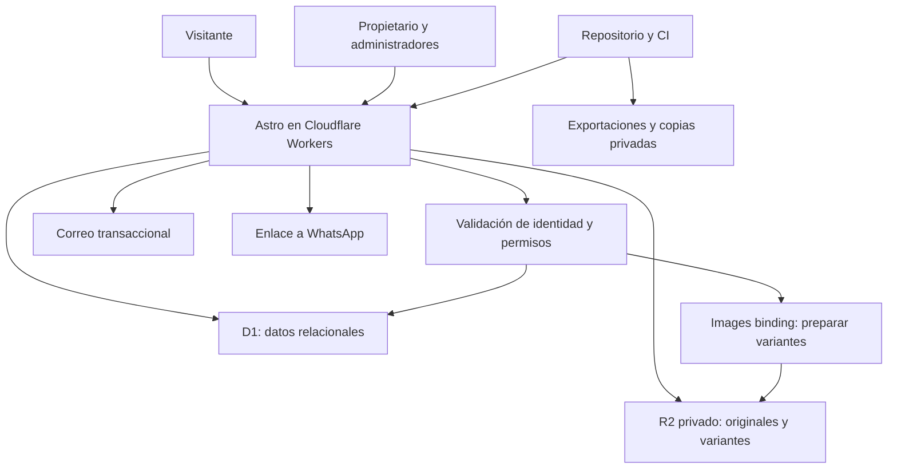

# Gestión Esencial: plan de desarrollo y despliegue

> Actualización aceptada e implementada en local (7 de noviembre de 2026): propietario y administradores con correo/contraseña, sesiones revocables y recuperación simulada. El usuario confirmó almacenar hashes y metadatos técnicos, contar sesiones (no dispositivos exactos) y distinguir cerrar sesiones de bloquear nuevos ingresos. La sección 18 y [06_PLAN_USUARIOS_Y_SESIONES.md](06_PLAN_USUARIOS_Y_SESIONES.md) prevalecen sobre las estimaciones históricas de Access y administrador único. Falta validar y conectar autenticación y correo de producción.

Fecha del plan: **24 de octubre de 2026**. Alcance funcional aceptado por el usuario en esta fecha. Actualización del **25 de octubre de 2026**: primera versión local implementada para revisión; no se ha desplegado ni contratado infraestructura. Consultar `05_VERSION_LOCAL.md` para el alcance disponible, las validaciones y las diferencias temporales del adaptador local respecto al destino Cloudflare.

Base: `01_CONTEXTO_Y_RECURSOS.md`, `02_PLAN_DE_DEFINICION.md` y `03_MODELO_DE_DATOS_3FN.md`. Este documento concreta el segundo plan solicitado. Los originales de marca siguen siendo la referencia visual.

## 1. Recomendación y decisiones principales

Construir una aplicación **Astro + TypeScript**, con panel de administración propio, alojada en **Cloudflare Workers**, base de datos **Cloudflare D1**, archivos privados en **R2** y acceso administrativo mediante **cuentas de correo/contraseña, roles y sesiones en servidor**. Agregar correo transaccional para invitaciones, recuperación y avisos. Usar **Drizzle** para el esquema y las consultas, y componentes React únicamente donde la interacción del administrador los justifique.

Es una aplicación única con módulos separados, no varios servicios independientes. Esta organización permite compartir reglas de publicación, precio y medios sin pagar un servidor permanente ni mantener dos aplicaciones distintas.

**Ruta económica:** desarrollar y medir en los niveles gratuitos. El lanzamiento en Workers Free será válido únicamente si supera las pruebas de CPU, carga y operación indicadas aquí. Si no cumple, usar Workers Paid con la misma arquitectura. No degradar autenticación, validaciones o fidelidad visual para forzar el plan gratuito.

El panel propio responde a requisitos concretos: ficha por familia, precio informativo calculado, relación proyecto–producto, borrado lógico recuperable y edición limitada a la estructura de marca. Tiene más trabajo inicial de desarrollo que un CMS instalado; a cambio, el administrador recibe formularios ajustados al negocio y no necesita adaptar una tienda electrónica.

## 2. Alcance de la primera versión

### Incluido

- Inicio con carrusel, categorías, destacados, servicios, proyectos, presentación corporativa y contacto.
- Catálogo con búsqueda por nombre/SKU interno, filtros pertinentes y paginación.
- Fichas de producto con imágenes, precio final COP por caja/unidad completa, equivalentes informativos, descripción y especificaciones.
- Proyectos con referencia propia, ciudad, sector, galería y productos utilizados públicos.
- Recorrido proyecto → producto → WhatsApp; respaldo textual de obras en producto, sin enlaces inversos.
- Panel para propietario y administradores: carga manual, edición, publicación, ocultación y recuperación, contenidos de landing y orden de imágenes. El propietario invita/desactiva/restaura cuentas y controla sesiones; cada usuario gestiona su contraseña y sesiones propias.
- SKU externo privado/opcional; SKU interno público con tratamiento visual secundario.
- Modelo 3FN, validaciones, bitácora de operaciones, exportación, copias y procedimiento de recuperación.
- Adaptación a móvil/tableta/escritorio, accesibilidad básica verificable, SEO técnico y despliegue.

### Límites deliberados de esta versión

No incluye compras/pagos, inventario en tiempo real, CRM, importación masiva, cuentas de clientes, bot de WhatsApp, editor libre de páginas, traducciones, formulario público de contacto con envío de correo ni historial completo restaurable de cada edición. Sí incluye los roles propietario/administrador y correo transaccional de seguridad. La información técnica estará en la página; PDF adjunto y analítica de clics quedan para una ampliación si se requieren.

Conservar registros ocultos y eventos no reconstruye automáticamente cada versión anterior. Las copias permiten recuperación operacional, no un botón de deshacer cualquier edición. La primera versión mantiene esa distinción.

## 3. Stack seleccionado para el plan

| Capa | Tecnología | Función y motivo |
| --- | --- | --- |
| Lenguaje | TypeScript con comprobación estricta | Contratos compartidos y errores detectables antes de desplegar. |
| Web y servidor | Astro, adaptador oficial `@astrojs/cloudflare` | HTML renderizado en servidor para contenido editable; endpoints y páginas dentro del mismo proyecto. |
| Estilos | CSS propio, variables de diseño y componentes reutilizables | Reproducir la marca sin imponer la apariencia de un kit de interfaz. |
| Interacción | TypeScript ligero; React en formularios complejos del panel | Galerías, selección de productos y ordenamiento; no enviar React a toda la web pública. |
| Validación | Zod y reglas del dominio en servidor | Validar campos, precios, unidades, publicación y parámetros de consulta. |
| Persistencia | D1, SQL compatible con SQLite | Mantener tablas y relaciones del diseño 3FN con claves, índices y restricciones. |
| Acceso a datos | Drizzle ORM/Kit y SQL revisado | Esquema tipado, migraciones y consultas parametrizadas; SQL explícito cuando lo exija D1. |
| Archivos | R2 Standard privado | Originales y variantes optimizadas, separados de la base de datos. |
| Imágenes | Cloudflare Images binding, transformación al cargar | Procesar originales privados y guardar tamaños fijos en R2; evitar transformar en cada visita. |
| Acceso administrativo | Cuentas propias, hashes de contraseñas y sesiones revocables | Permisos propietario/administrador; sin dependencia de IP fija. Biblioteca de producción sujeta a validación en Workers/D1. |
| Correo de seguridad | Proveedor transaccional, candidato Resend | Invitaciones, recuperación y avisos; buzón simulado únicamente en local. |
| Calidad | Vitest, Playwright y revisión visual | Reglas del negocio, integración con D1/R2 y recorridos reales. |
| Herramientas | Node LTS compatible, pnpm, Git, Wrangler y GitHub Actions | Desarrollo reproducible, CI, migraciones, despliegue y exportaciones. |

Astro tiene una ruta oficial de despliegue en Workers con renderizado bajo demanda. Drizzle dispone de soporte específico para D1. En la fase 0 se fijarán versiones **estables compatibles**, archivo de bloqueo y fecha de compatibilidad de Workers; no adoptar versiones preliminares ni actualizar automáticamente versiones mayores. Fuentes: [Astro en Workers](https://developers.cloudflare.com/workers/framework-guides/web-apps/astro/) y [Drizzle con D1](https://orm.drizzle.team/docs/sqlite/connect-cloudflare-d1).

Node se usa para desarrollo y compilación; el servidor de producción corre en Workers. No asumir que cualquier paquete nativo de Node funciona allí. Esta distinción es especialmente importante para procesar imágenes y verificar tokens.

## 4. Arquitectura y publicación



### Rutas previstas

| Ruta | Uso |
| --- | --- |
| `/` | Inicio editable. |
| `/catalogo` | Búsqueda, filtros y páginas de productos. |
| `/productos/[slug]` | Ficha pública de producto. |
| `/proyectos` y `/proyectos/[slug]` | Portafolio y detalle. |
| `/nosotros` | Información corporativa; servicios/contacto accesibles desde Inicio. |
| `/media/[recurso]/[variante]` | Imagen optimizada, únicamente después de comprobar un uso público vigente. |
| `/admin` y `/admin/*` | Panel y endpoints privados, con sesión y permisos; lista explícita de excepciones de acceso/activación/recuperación, sin datos privados. |
| `/sitemap.xml` y `/robots.txt` | Descubrimiento de páginas publicadas y reglas de rastreo. |

La API administrativa vivirá bajo `/admin/api/*` para reducir el riesgo de proteger la pantalla y olvidar los endpoints. Acciones/servidor de Astro que se expongan fuera de ese prefijo deberán tener la misma autorización explícita; no usar rutas automáticas sin comprobar su cobertura.

### Estrategia de lectura

- Renderizar contenido editable bajo demanda: los cambios no requieren reconstruir todo el sitio.
- Al principio, no cachear HTML/JSON con datos comerciales o de publicación: `Cache-Control: no-store`. Evitar contenido oculto todavía visible por una caché antigua.
- CSS, JavaScript y recursos fijos de marca sí pueden tener caché larga y nombres versionados.
- El acceso a imágenes consulta D1 antes de devolver bytes. La respuesta pública será `no-store` al inicio; las variantes ya están transformadas en R2, de modo que no se procesa la imagen en cada visita.
- No activar caché de respuestas completa, reglas «cache everything», service worker ni atajos CDN que salten esa comprobación. Si el tráfico lo justifica, añadir caché interna de bytes inmutables **después** de verificar visibilidad, preservando la comprobación en cada petición.
- Desactivar réplicas de lectura en el lanzamiento para no introducir lecturas antiguas después de ocultar. Cualquier réplica futura necesitará una estrategia de consistencia explícita.

Esta elección favorece una ocultación predecible. Consume más peticiones de Worker/D1 que servir todo desde archivos públicos; el dimensionamiento y las pruebas incluyen ese costo. No se garantiza retirar imágenes que alguien ya descargó.

## 5. Datos: de 3FN a esquema ejecutable

Implementar el núcleo de `03_MODELO_DE_DATOS_3FN.md`: productos/datos privados, presentaciones y medidas, fichas, catálogos, proyectos, ubicaciones, asociaciones, imágenes, contenido y eventos. Una categoría principal por producto y un sector principal por proyecto en esta versión.

### Decisiones físicas

- IDs estables; SKU y slug únicos incluso si el registro está oculto. Referencias por ID, nunca por nombre ni SKU editable.
- Dinero en **enteros de centavos COP**, con nombres físicos que expresen esa escala; cantidades y dimensiones en enteros escalados a 4 decimales cuando sea necesario. Conversión validada en los límites del sistema.
- Cálculos intermedios con enteros/aritmética exacta; verificar límites seguros de almacenamiento y serialización. Redondear el equivalente solo al mostrarlo, sin editarlo ni persistirlo como otro precio.
- FK activas, restricciones de valor positivo, unicidad de parejas y validación de cantidades enteras para piezas.
- Índices en SKU, slug, estado/borrado, categoría, ciudad/sector y ambos sentidos de la asociación. Verificar planes de consulta y filas leídas; no indexar cada columna por costumbre.
- Búsqueda inicial parametrizada sobre nombres y SKU internos, con longitud y resultados limitados. En un catálogo pequeño no se necesita contratar un buscador externo.
- Ediciones consistentes de precio, medida y ficha en una operación atómica. D1 ofrece lotes transaccionales mediante `batch()`; no asumir soporte de transacciones interactivas del ORM sin validarlo. [API de D1](https://developers.cloudflare.com/d1/worker-api/d1-database/).
- Control de edición concurrente con revisión del registro o `updated_at`: si otra pestaña cambió el registro, devolver conflicto en vez de sobrescribir silenciosamente. La comparación y las escrituras deben protegerse en la misma operación.

### Extensiones técnicas al modelo lógico

1. `RECURSO_VARIANTE`: FK al original, código de variante, clave privada, dimensiones, tamaño y estado. UQ `(recurso_id, variante_codigo)`. No es una variante comercial de producto.
2. Estado de preparación del recurso: pendiente, listo o fallido. Evitar publicar un registro cuya imagen todavía no se puede servir.
3. Marca de revisión para evitar ediciones perdidas e identificador idempotente para reintentar cargas sin duplicarlas.
4. Bitácora administrativa para contenidos/medios además de producto, proyecto y asociación, con referencias concretas a cada entidad.

No duplicar nombre de categoría ni precio calculado en estas tablas. Son extensiones operativas del mismo modelo, no una sustitución de 3FN.

### Ocultación y recuperación

Todas las lecturas públicas usan un servicio común de visibilidad. Ocultar conserva hijos y asociaciones, pero impide resultados públicos, detalle directo, metadatos, sitemap e imágenes sin otro uso publicado. Restaurar devuelve a borrador. No hay eliminación física de datos de negocio ni limpieza automática de archivos históricos.

Cambiar un precio requiere que el administrador lo ingrese: la web no conoce stock o tarifas del proveedor. La fecha de actualización ayudará a revisar datos, pero no se presentará como sincronización automática.

## 6. Imágenes, recursos visuales y fidelidad

### Preparación inicial de marca

- Exportar del material entregado logos vectoriales, iconos y fotografías útiles, manteniendo los originales intactos.
- Aplicar `#011F5F`, `#1F4F78`, blancos y tonos auxiliares coherentes; comprobar contraste de los tonos secundarios.
- Resolver Gill Sans MT regular y licencia web. No publicar fuentes por el mero hecho de tener un TTF. Si no se obtiene, presentar una alternativa visual cercana durante la preparación de diseño, sin cambiar silenciosamente la identidad.
- Recortar márgenes de exportación sin invadir el área de seguridad del logo. Preparar favicon desde el símbolo G.
- Usar nombres e imágenes demostrativos para desarrollo, claramente separados del contenido real. No publicar obras ficticias como realizadas por la empresa.

### Flujo de carga del administrador

1. Recibir archivo autenticado con límite inicial de 10 MB, formatos JPEG/PNG/WebP, máximo de dimensiones/píxeles y validación real del contenido. Sin SVG, HTML, animaciones, URL remota arbitraria ni PDF en esta primera carga de fotografías.
2. Guardar original en R2 privado con clave nueva y registro pendiente; no sobrescribir un original anterior.
3. Inspeccionar dimensiones y preparar variantes fijas, por ejemplo 480, 960 y 1600 px, sin ampliar imágenes pequeñas. WebP como formato inicial; recortes de tarjetas mediante composición CSS, conservando el material completo en galería.
4. Guardar variantes privadas e identificar el recurso como listo. Procesamiento por imagen/variante y reintentos idempotentes; no subir cientos de archivos dentro de una petición.
5. Si falla, mostrar error recuperable y conservar el archivo privado; no dejar un producto publicado con enlaces rotos.

La transformación se realizará mediante el binding de Images, que acepta bytes de R2 sin exigir un original público. Las variantes se guardarán y reutilizarán, evitando procesamiento pesado en el Worker y solicitudes repetidas de transformación. [Optimización desde Workers](https://developers.cloudflare.com/images/optimization/binding/).

El endpoint de imagen admitirá solo códigos de variante conocidos, no anchos arbitrarios. Se validará eliminación de metadatos sensibles en las variantes públicas. Los originales seguirán privados incluso cuando el producto sea público.

### Composición responsive

Mantener encabezado blanco, tratamiento azul, fotografía protagonista, títulos y pies de tarjeta de los diseños. Catálogo: tres columnas en escritorio cuando el ancho lo permita, dos en tableta y una/dos en móvil según legibilidad. Proyectos: dos columnas amplias y una en móvil. Filtros pasan a panel desplegable accesible; ficha de producto apila galería e información sin esconder precio/WhatsApp.

Carrusel inicial de tres diapositivas, manual por defecto, controles de teclado y movimiento reducido. Primer banner carga con prioridad; las demás imágenes y galerías secundarias se cargan cuando se necesitan. No descargar todas las fotos en el primer render.

## 7. Seguridad y privacidad

### Acceso administrativo

- Correo y contraseña, sin registro público ni contraseña predeterminada. Alta inicial privada del dueño; los siguientes usuarios se activan por invitación.
- El servidor comprueba cuenta activa, rol, sesión, expiración y revocación en cada ruta privada. Se protegen pantallas, APIs, exportaciones y medios privados. El rol enviado por el cliente nunca concede permisos.
- Contraseñas con hash y sal; sesiones opacas revocables. Recuperación mediante token de un uso y vencimiento. Cambiar contraseña cierra todas las sesiones. Desactivar impide nuevo acceso sin borrar autoría.
- Cloudflare Access deja de ser dependencia del acceso del dueño; puede reservarse para previews internos. Proteger correo del dueño y cuentas de infraestructura con MFA.
- Bloquear acceso administrativo desde dominios alternativos, previews y `workers.dev` sin la misma protección. Ninguna bandera de desarrollo puede habilitar escritura remota sin autenticación.
- Validación de origen y token anti-CSRF en operaciones mutables; solo métodos permitidos, sin cambios por GET. Cookies/sesiones seguras cuando las gestione la aplicación.

### Contenido, archivos y secretos

- Validar en servidor aunque el formulario también valide. Consultas parametrizadas y selección explícita de campos públicos.
- SKU externo nunca en HTML, JSON público, buscador, enlaces, eventos de clic ni registros de errores compartidos.
- Texto escapado; evitar HTML libre para descripciones. Si se permite formato limitado, usar sanitización con lista de elementos admitidos.
- CSP, protección frente a inclusión en marcos, `nosniff`, política de referencias y HTTPS obligatorio. Probar las políticas con el login y el flujo real.
- R2 sin `r2.dev` ni bucket público. Medios administrativos requieren autorización; las fotos públicas dependen de una asociación publicada comprobada.
- Límites de carga, filtros y paginación; protección contra abuso sin contratar funciones innecesarias. Identificar qué controles están disponibles en cada plan durante fase 0.
- Tokens de CI de privilegio mínimo y por entorno; secretos fuera de código/repositorio. D1 y R2 mediante bindings de servidor.
- No registrar contraseñas, tokens, cookies, enlaces de recuperación, datos privados o contenidos íntegros de solicitudes. Los errores públicos serán genéricos y los detalles operativos estarán protegidos.

## 8. Fases, entregables y orden de ejecución

Estimación inicial para una persona desarrolladora con dedicación sostenida: **21–32 jornadas efectivas**, aproximadamente **4–7 semanas**. Incluye desarrollo y validación; no es una fecha comprometida ni una cotización de mano de obra. La entrega de contenido real y acceso a cuentas puede cambiar el calendario.

| Fase | Trabajo y entregables | Dependencias | Salida verificable | Esfuerzo |
| --- | --- | --- | --- | --- |
| 0. Base y prueba técnica | Repo, configuración, versiones, prueba Astro/D1/R2/Images/Access; un producto con imagen y precio; medición en entorno real. | Identidad de prueba y servicios de desarrollo cuando haga falta validación remota. | Lectura, escritura autorizada, imagen privada y ocultación funcionan; se decide Free viable o Paid necesario. | 1–2 días |
| 1. Sistema visual | Recursos exportados, variables, componentes, composición de Inicio/catálogo/producto/proyecto y móvil. | Inventario existente. | Comparación visual con PDF; carrusel, ficha y panel de filtros legibles. | 3–4 días |
| 2. Datos y dominio | Migraciones 3FN, catálogos base, validaciones, cálculos exactos, visibilidad, bitácora y semillas de ejemplo. | Fase 0. | Integridad, cálculos y ocultación comprobados con pruebas de integración. | 3–5 días |
| 3. Productos y medios | CRUD real, carga y orden de imágenes, ficha por familia, publicación, recuperación y previsualización. | Fases 1–2. | Crear un producto desde panel y consultarlo hasta WhatsApp sin intervención en código. | 4–6 días |
| 4. Proyectos y landing | Referencias, asociación de productos, galerías, carrusel/servicios/contacto y selección editorial. | Productos funcionales. | Proyecto → producto → WhatsApp; ocultación coherente en todas las relaciones. | 3–4 días |
| 5. Web completa | Catálogo, filtros, buscador, páginas, SEO, estados vacíos/404, adaptación y accesibilidad. | Módulos de contenido disponibles. | Recorridos completos y páginas compartibles con información actual. | 3–5 días |
| 6. Calidad y operación | Pruebas de seguridad, carga, restauración, control de costos, documentación y formación del administrador. | Aplicación completa. | Criterios de lanzamiento cumplidos; recuperación ensayada. | 3–4 días |
| 7. Publicación | Dominio/DNS, certificados, migraciones producción, carga piloto, pruebas finales y entrega. | Contenido inicial válido y cuentas propias de la empresa. | Producción operativa y administrador capaz de mantenerla. | 1–2 días |

La fase 0 evita descubrir incompatibilidades de plataforma o costos al final. Las fases siguientes se revisarán por entregable funcional, sin esperar a completar todo el sitio para comprobar el recorrido comercial.

### Organización propuesta del código

```text
src/
  pages/                 rutas públicas, admin y media
  components/            componentes visuales reutilizables
  styles/                identidad y estilos responsive
  domain/                precios, unidades, publicación y relaciones
  server/
    auth/                identidad, autorización y CSRF
    db/                  esquema, consultas públicas y administrativas
    media/               carga, variantes y visibilidad de archivos
    services/            operaciones de negocio y bitácora
  validation/            contratos de entrada y salida
migrations/              SQL versionado
tests/                   dominio, integración y recorridos
docs/                    operación, recuperación y uso del panel
```

## 9. Pruebas y criterios para lanzar

| Área | Comprobaciones relevantes |
| --- | --- |
| Precios | Caja de 120.000 / 1,60 m² = 75.000; saco y pieza completos; cero/nulos rechazados al publicar; redondeo consistente. |
| Datos | SKU único incluso oculto; parejas únicas; FK válidas; edición conserva relaciones; conflicto entre dos pestañas no pierde datos. |
| Autorización | Usuario anónimo o identidad distinta no lee ni modifica administración; token ausente, vencido o audiencia incorrecta falla; origen no permitido no escribe. |
| Privacidad | Buscar SKU externo no produce resultados; inspeccionar HTML/JSON/metadatos no lo revela. |
| Soft delete | Ocultar producto/proyecto retira catálogo, búsqueda, páginas, referencias, sitemap e imágenes sin uso público; URL anterior deja de servir contenido; restaurar queda en borrador. |
| Recursos compartidos | Ocultar un uso no rompe otra página publicada que utiliza la misma imagen; una asociación retirada no se reactiva por restaurar el padre. |
| Medios | Archivo falso/sobredimensionado rechazado; fallo de conversión recuperable; original no accesible; variantes y carga diferida funcionan. |
| Recorrido comercial | Proyecto → producto → enlace WhatsApp con mensaje correcto, sin envío automático; texto de obras sin enlaces inversos. |
| Diseño | Comparación contra referencias; móvil, tableta y escritorio; teclado, etiquetas, foco, contraste y carrusel usable. |
| Recuperación | Restaurar exportación y medios en entorno aislado y comprobar relaciones y archivos. |

Pruebas de integración en el runtime compatible de Workers/D1; pruebas de acceso real en entorno protegido. Los mocks unitarios no sustituyen estas verificaciones.

Objetivos iniciales, a medir y ajustar con imágenes reales: sin errores de cuota/CPU; CLS ≤ 0,1 y LCP móvil ≤ 2,5 s en pruebas controladas representativas. No prometer estos resultados con cualquier red/dispositivo. Evaluar INP con uso real cuando haya datos. Mantener carga inicial de Inicio alrededor de 1–1,5 MB cuando la fotografía lo permita.

**Puerta de Workers Free (actualizada):** probar páginas representativas, creación/verificación de contraseñas con parámetros seguros, login, recuperación, consulta/revocación de sesiones, consultas complejas y procesamiento de medios. Contrastar CPU/memoria con límites vigentes y exigir margen operativo. Si el hash excede Free, evaluar Paid o un proveedor de identidad compatible; nunca reducir el coste criptográfico. Una simulación local no demuestra rendimiento en producción. Recalcular el presupuesto antes de contratar.

## 10. Dimensionamiento y escalabilidad

«150» es el volumen inicial indicado, sin desglose. Para estimar se adopta un **escenario**, no un nuevo requisito: 150 registros totales, 5 fotos por registro, 3 MB por original y 0,6 MB sumando sus variantes. Resultado aproximado: 750 originales, **2,7 GB** de archivos actuales y 2.250 transformaciones en la carga inicial. Se añaden marca, banners, copias y reemplazos históricos.

| Escenario ilustrativo | Originales | Archivos actuales aproximados, sin histórico ni backups |
| --- | ---: | ---: |
| 150 registros × 5 fotos | 750 | 2,7 GB |
| 300 registros × 5 fotos | 1.500 | 5,4 GB |
| 1.000 registros × 5 fotos | 5.000 | 18 GB |

El histórico de reemplazos crece aunque no aumente el número de productos. No borrar originales para reducir factura; primero medir, presupuestar y evaluar niveles de almacenamiento con sus costos de recuperación.

Ejemplo de tráfico: 500 sesiones/día × 4 páginas × (1 HTML + 6 imágenes) ≈ **14.000 invocaciones/día**, más búsquedas, administración, bots y otros recursos dinámicos. Los 100.000 del plan Free son peticiones, no visitantes. Una galería muy grande o un rastreador puede consumir la cuota rápidamente.

### Evolución prevista

1. Inicio: consultas indexadas, paginación de 24 productos, filtros acotados, imágenes preparadas y una sola región de escritura.
2. Al acercarse a límites: revisar consultas y tráfico; pasar a Workers Paid sin cambiar el modelo, antes de depender de una cuota agotada. Umbral de revisión interno: 70% de peticiones, almacenamiento o transformaciones, no una promesa de corte de gasto del proveedor.
3. Si crece el catálogo: búsqueda SQL especializada, caché de bytes tras validación y paginación por cursor cuando resulte necesario. No añadir buscador externo o réplicas por anticipado.
4. Si aparecen alta concurrencia de escritura, muchas cuentas, integraciones o consultas complejas: medir y evaluar PostgreSQL. Conservar servicios de dominio separados del adaptador D1 facilita migración, pero requiere convertir SQL, datos y pruebas; no será un cambio automático.

No subir fotos a la base de datos ni representar toda la ficha como JSON genérico. La mayor demanda inicial probablemente estará en imágenes, no en las filas de productos; se confirmará con mediciones.

## 11. Despliegue y entornos

- **Local:** Wrangler/runtime compatible y datos ficticios. Sin conexiones de escritura accidental a producción.
- **Pruebas:** Worker, D1 y bucket separados; protegido por Access y sin indexación. Compartir código, no credenciales ni contenido privado de producción.
- **Producción:** dominio de la empresa, bindings propios, política de acceso revisada y contenido válido. Recursos y cuotas de la misma cuenta pueden acumularse entre entornos.

### Flujo de entrega

1. Guardar código, migraciones y configuración declarativa en repositorio privado. Los AI/PDF originales pesados y fotos comerciales no forman parte del paquete desplegado.
2. CI ejecuta tipos, pruebas pertinentes y build; no despliega si falla.
3. Aplicar migraciones en pruebas y validar la versión candidata.
4. Preparar exportación de datos antes de cambiar el esquema en producción. Preferir migraciones aditivas y compatibles con la versión anterior.
5. Desplegar Worker y recursos estáticos; ejecutar comprobación pública y administrativa. Proteger los entornos preliminares.
6. Si falla el código, volver a la versión anterior compatible. Revertir código **no** revierte automáticamente la base de datos; reparar hacia adelante o restaurar según el procedimiento ensayado.

Registrar dominio/DNS en cuentas propiedad de la empresa, habilitar renovación y recuperación, y elegir una URL canónica con redirección de la alternativa www. No se asume disponibilidad de ningún nombre ni se cambia correo existente al modificar DNS.

Los certificados HTTPS administrados de Cloudflare cubren este uso sin comprar un certificado comercial separado. Verificar emisión y cobertura de los nombres utilizados antes de publicar. [Universal SSL](https://developers.cloudflare.com/ssl/edge-certificates/universal-ssl/).

## 12. Copias, mantenimiento y recuperación

- Exportación diaria de D1, almacenada de forma privada con fecha, versión de migración y checksum. Se propone ejecutarla desde un job de CI; documentar consumo de minutos y fallos, sin asumir que los minutos son ilimitados.
- Copia independiente semanal de datos y originales nuevos, cifrada y fuera de la cuenta principal de Cloudflare, por ejemplo en almacenamiento ya disponible de la empresa. Si no existe capacidad, incluir su costo antes de cerrar la operación.
- Comprobar que exportación y manifiesto de archivos corresponden al mismo punto lógico. Los originales inmutables simplifican la consistencia, pero la carga pendiente no debe aparecer como completa en una restauración.
- Conservar registros y archivos históricos según lo acordado. Definir retención de **copias redundantes** por separado; no implantar purga de contenidos comerciales bajo el pretexto de rotar backups.
- D1 dispone de recuperación temporal; no reemplaza la copia externa ni un historial de ediciones. [Time Travel y backups](https://developers.cloudflare.com/d1/reference/time-travel/).
- Objetivo operacional inicial: hasta 24 h de cambios recuperables desde copia diaria y restauración en una jornada de atención del responsable. Son objetivos que deben ensayarse, no un SLA contratado. La copia semanal fuera del proveedor implica hasta 7 días de exposición si se pierde completamente la cuenta principal.
- Revisar mensualmente dependencias, gasto, cuotas y estado de copias; ensayar restauración cada trimestre y después de cambios importantes de esquema.
- Documentar alta/recuperación del administrador, DNS, renovación del dominio, claves de servicio, publicación, soft delete y restauración. El propietario conserva acceso y códigos de recuperación.

El mantenimiento técnico y la carga de contenidos son trabajo separado del precio del hosting. El presupuesto de $200.000 COP fue destinado a servicios, no a honorarios de desarrollo o soporte.

## 13. Precios y límites verificados

Valores consultados en fuentes oficiales el **24 de octubre de 2026**. Los importes en USD pueden generar impuestos y conversión de la tarjeta. Las cuotas se comparten según producto/cuenta; no asumir que cada entorno obtiene una cuota independiente.

| Servicio | Nivel inicial / referencia actual | Implicación |
| --- | --- | --- |
| Workers Free | 100.000 peticiones/día y 10 ms CPU/invocación. | Viabilidad condicionada a prueba; un pico o cómputo excesivo puede fallar. |
| Workers Paid | Base USD 5/mes; incluye 10 millones de peticiones y 30 millones de ms CPU/mes, con cobro por excedentes. | Alternativa inmediata sin migrar arquitectura; la tarifa se publica por mes, no como prepago anual. |
| D1 Free | 5 millones de filas leídas/día; 100.000 escritas/día; 5 GB totales en cuenta. | Se factura/limita por filas leídas, no solo por número de consultas. |
| Límite de una D1 | 500 MB Free / 10 GB Paid; recuperación temporal 7/30 días. | No confundir los 5 GB de cuenta con el tamaño permitido de una sola base gratuita. |
| R2 Standard | 10 GB-mes, 1 millón de operaciones A y 10 millones B incluidos por mes; almacenamiento adicional USD 0,015/GB-mes; egreso sin cargo de R2. | Worker y operaciones siguen contando; verificar redondeo de unidades facturables y acumulación del histórico. |
| Images Free | 5.000 transformaciones únicas/mes; excederlo bloquea transformaciones nuevas. | Tamaños fijos y preparación al cargar; no publicar imágenes a medio procesar. |
| Images Paid | Primeras 5.000 incluidas; adicionales USD 0,50 por 1.000 transformaciones. | No contratar almacenamiento de Images: las imágenes estarán en R2. |
| Access/Zero Trust Free | Hasta 50 usuarios. | Suficiente para un administrador; no habilita acceso público a la cuenta. |
| Certificados | Universal SSL gratuito para los nombres cubiertos. | No reservar un pago separado de certificado para esta arquitectura. |

Fuentes: [Workers](https://developers.cloudflare.com/workers/platform/pricing/), [tarifas D1](https://developers.cloudflare.com/d1/platform/pricing/), [límites D1](https://developers.cloudflare.com/d1/platform/limits/), [R2](https://developers.cloudflare.com/r2/pricing/), [Images](https://developers.cloudflare.com/images/pricing/), [Access/Zero Trust](https://www.cloudflare.com/plans/) y [certificados](https://developers.cloudflare.com/ssl/edge-certificates/universal-ssl/).

Configurar avisos de uso y revisión de facturación. Un aviso de presupuesto no es necesariamente un límite duro: no prometer una factura máxima sin verificar qué controles ofrece cada producto. Activar R2 u otros servicios puede requerir datos de facturación aunque el consumo esté dentro de la cuota gratuita.

## 14. Presupuesto de arranque y costo anual

El nombre de dominio todavía no se eligió. Reservar **hasta $100.000 COP** como objetivo de compra anual para un dominio no premium; es una asignación de presupuesto, **no una tarifa verificada para un nombre concreto**. Verificar precio de registro y renovación antes de elegirlo. Cloudflare Registrar publica registro/renovación a costo, sin que eso fije el precio de todos los dominios. [Registrar](https://www.cloudflare.com/domains/).

Para ilustrar conversiones se usa **$4.500 COP/USD como supuesto de cálculo**, no como TRM actual ni cotización. El gasto real depende de conversión, impuestos y consumo.

| Concepto | Arranque con Free viable | Arranque con Workers Paid |
| --- | ---: | ---: |
| Reserva objetivo para dominio anual | $100.000 COP | $100.000 COP |
| Workers | $0 dentro de cuota | Primer mes: USD 5 ≈ $22.500 COP |
| Certificado administrado | $0 | $0 |
| D1/R2/Images/Access | $0 si el uso total permanece incluido | $0 adicional si el uso permanece incluido |
| Subtotal ilustrativo de arranque | $100.000 COP | $122.500 COP |
| Margen hasta los $200.000 iniciales | $100.000 COP | $77.500 COP |

El margen absorbe variación del dominio, impuestos, cambio o consumos; no garantiza cubrir cualquier importe. Copia externa usa capacidad existente solo si realmente está disponible. Correo empresarial, licencia de fuente, dominio premium y almacenamiento externo nuevo no están cubiertos por cifras ficticias de cero: cotizarlos aparte si se requieren.

### Horizonte de doce meses

- **Free viable:** dominio real y consumos que excedan cuotas; con el supuesto de dominio anterior, base ilustrativa de $100.000 COP/año antes de extras.
- **Workers Paid todo el año:** USD 60 ≈ $270.000 COP de Workers + $100.000 de dominio = **$370.000 COP/año** antes de impuestos/excedentes y otros servicios necesarios.
- El segundo escenario cabe en $200.000 **de arranque con el primer mes**, pero no en un tope de $200.000 para doce meses completos. La preferencia de facturación anual se aplica al dominio; para Workers se reserva un presupuesto anual aunque su cobro base sea mensual.

**Decisión recomendada:** conservar la arquitectura Cloudflare en ambos escenarios. Intentar el lanzamiento gratuito con resultados medidos; si no supera calidad, elegir Paid y reconocer el costo recurrente, sin esconderlo tras una promesa de hosting gratis.

## 15. Alternativas consideradas

| Alternativa | Costos observados / condiciones | Evaluación para este caso |
| --- | --- | --- |
| Cloudflare Workers + D1 + R2 + Access | Ruta gratuita condicionada o base de Workers de USD 5/mes más consumos. | Preferida por ajuste económico, integración y control de la aplicación. |
| Vercel Pro + Supabase Pro | Vercel Pro USD 20/mes y Supabase Pro desde USD 25/mes: base conjunta USD 45/mes, antes de extras. | Buen ecosistema, pero sobredimensiona el gasto inicial. No usar Vercel Hobby para una web comercial. |
| Cloudflare con Supabase Free | Base Supabase gratuita, 500 MB de DB y 1 GB de archivos; pausa tras una semana sin actividad. | Posible para pruebas, pero añade proveedor y límites. No aporta suficiente ventaja sobre D1/R2 para esta primera versión. |
| WordPress en hosting compartido, por ejemplo Hostinger | Oferta observada Single: $4.900 COP/mes equivalente, **$235.200 COP por 48 meses**, renovación anunciada a $17.900/mes. | El desembolso de esa oferta supera el presupuesto inicial. Un plazo distinto necesita otra cotización. Usar WordPress exigiría revisar cómo implementar el modelo 3FN, ocultación y panel; no es el mismo proyecto simplemente cambiando de hosting. |

Fuentes: [Vercel Pro](https://vercel.com/pricing), [restricción de Hobby](https://vercel.com/docs/plans/hobby), [Supabase](https://supabase.com/pricing) y [oferta WordPress de Hostinger](https://www.hostinger.com/co/hosting-wordpress). Las promociones cambian; comparar siempre desembolso, renovación y servicios incluidos, no solo el precio mensual grande del anuncio.

No se recomienda administrar un VPS para este tamaño: la instalación, parches, copias, seguridad y recuperación recaerían en el responsable del proyecto. Es una decisión de operación, no una afirmación de que un VPS no pueda alojar el sitio.

## 16. Riesgos, dependencias y reversibilidad

| Punto | Tratamiento previsto |
| --- | --- |
| CPU Free insuficiente | Medir en fase 0 y al completar la web; Paid sin cambio de stack. |
| Más fotos/histórico del esperado | Medir bytes, variantes, copias y transformaciones; avisar antes de cuotas. |
| Fuentes/imágenes aún referenciales | Resolver recursos en fase visual; separar ejemplos de producción. |
| Disponibilidad/precio incorrecto | Gestión manual, revisión previa a publicar y ocultación inmediata; no simular inventario automático. |
| Dependencia de Cloudflare | Datos exportables como SQL y archivos por interfaces R2/S3; lógica de dominio separada. Migrar hosting/autenticación requerirá trabajo real. |
| Pérdida de acceso | Cuentas de la empresa, MFA, recuperación y copia fuera del proveedor. |
| Costos ocultos | Dominio/renovación, impuestos, consumo, backups, fuente y mantenimiento separados. |

No hay nuevas preguntas que impidan comenzar el desarrollo local. Para publicar harán falta el dominio elegido, cuenta propietaria de los servicios, identidad del administrador, número de WhatsApp, contenido real suficiente y recursos de marca utilizables. El volumen «150» se trata mediante escenarios hasta conocer su desglose.

## 17. Primer entregable de implementación

Empezar por la fase 0 y un recorrido mínimo completo: **crear un producto por caja con imagen y cobertura → publicarlo → consultarlo → abrir enlace WhatsApp → ocultarlo y comprobar que desaparece**. Después extender ese mismo núcleo al resto del catálogo, proyectos y landing.

Este plan deja seleccionada la arquitectura, el orden de trabajo y las condiciones de despliegue. No se han creado cuentas, contratado planes, comprado dominio ni desplegado la aplicación durante su elaboración.

## 18. Actualización aceptada: cuentas y sesiones — 7 de noviembre de 2026

Se incorpora el alcance de `06_PLAN_USUARIOS_Y_SESIONES.md`. Confirmaciones del usuario:

1. Solo se solicitan correo y contraseña como perfil. Se guardan el hash de contraseña y metadatos de rol, estado y sesiones necesarios para operar; nunca contraseñas legibles.
2. El panel cuenta **sesiones**, con navegador/sistema y última actividad orientativos, no dispositivos físicos exactos.
3. Cerrar sesiones revoca accesos existentes; para impedir un nuevo ingreso también se cambia la contraseña o se desactiva la cuenta.

### Implementación local disponible

- Propietario inicial configurable una sola vez, administradores por invitación, protección de roles en servidor y desactivación/restauración sin borrar cuentas.
- Sesiones opacas, almacenadas como hash, máximo de 12 horas y 60 minutos de inactividad; cierre individual/global y consulta de sesiones propias o ajenas según rol.
- Invitaciones de 24 horas, recuperación de 20 minutos, uso único, cambio de contraseña/correo y verificación reciente para gestión de otros usuarios.
- Buzón simulado local, explícitamente identificado como herramienta de prueba. No se envía correo real. Tanto el buzón como la configuración inicial visual son excepciones de revisión local y **no deben habilitarse públicamente**.
- Migración aditiva `003_accounts.sql`, invalidación de sesiones antiguas, autoría en nuevas operaciones de contenido y respaldo previo de la base existente.
- Adaptador local Node con `crypto.scrypt` (N=32768, r=8, p=3), SQLite y controles de concurrencia/revocación; no se ha instalado Better Auth ni validado este adaptador en Workers. La biblioteca candidata y su esquema requieren evaluación antes del despliegue. No se considerará esta revisión local una autenticación lista para producción.

### Pasos adicionales obligatorios para publicar

1. Validar la biblioteca/adaptador definitivo en Workers/D1 y la migración de hashes, roles y sesiones. Conservar una sola fuente de identidad. Probar revocación consistente, consumo de tokens atómico y carreras durante hashing.
2. Sustituir el buzón de prueba por correo transaccional (Resend candidato): dominio/remitente verificados, SPF/DKIM/DMARC, secretos por entorno y reintentos limitados. No copiar `local-mailbox.json` a producción ni incluirlo en backups compartidos.
3. Sustituir `/admin/configurar` por instalación privada del dueño e invitación a su correo real. La cuenta configurada en local se considera de revisión, no identidad de producción verificada por correo.
4. Eliminar las rutas y mecanismos de prueba de la compilación de producción. No basta esconder enlaces. Una prueba sin `LOCAL_PREVIEW` debe impedir el adaptador local, el buzón y el alta visual.
5. Cookies Secure bajo HTTPS, dominio canónico, protección de origen/CSRF y permisos en todas las rutas. La restricción localhost del servidor actual protege la revisión: no es una restricción por IP del administrador en producción.
6. Cambiar límites locales por límites compartidos aptos para múltiples instancias: intentos fallidos por cuenta, señales de origen confiables y presupuesto global de correo/CPU. Completar comprobación de contraseñas comprometidas; el rechazo local de patrones comunes no reemplaza esa comprobación.
7. Implementar retención/purga de datos técnicos según política acordada, alertas de seguridad/costo y procedimiento de recuperación excepcional del dueño. El modelo local registra eventos; no ejecuta todavía una tarea programada de retención.
8. Medir login, hash y recuperación en entorno real. Recalcular costos de Workers y correo; las tablas históricas de Access/JWT no representan el costo de esta solución. No reducir la dificultad del hash para mantener Free.
9. Probar entrega real de correo, fallos del proveedor, bloqueo de rutas de prueba, restauración de respaldo y todos los controles de permisos en previews/dominios alternativos. Invalidar sesiones y enlaces al restaurar; los respaldos completos contienen hashes y deben protegerse.

Se conservan Workers, D1, R2, Images, DNS, certificados y CI. Access queda opcional para previews internos, no como acceso del usuario final. No se contrató infraestructura ni se publicó la web en esta actualización.
